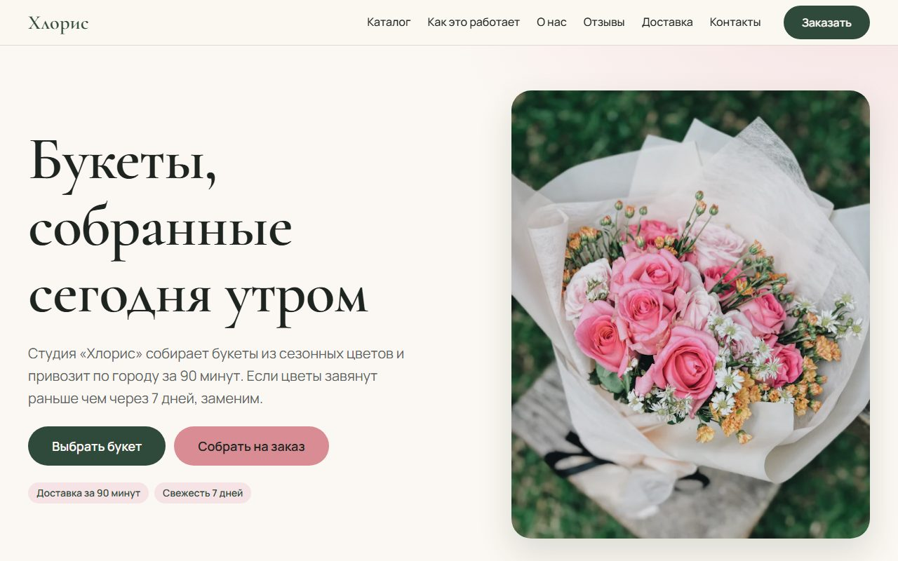

# Хлорис — лендинг цветочной студии

Портфолио-проект: одностраничный сайт вымышленной цветочной студии «Хлорис».
Бренд, тексты и контакты выдуманные.

**Сайт:** https://grozeser.github.io/chloris-flower-landing/ · **Кейс:** [docs/case-study.md](docs/case-study.md)



## Стек

Чистые HTML, CSS и JS, без сборки. Mobile-first, цель по доступности — WCAG AA.

## Запуск

```bash
python -m http.server 5500
```

Затем открыть http://localhost:5500.

Тесты проверки полей формы (Node 18+):

```bash
node --test
```

## Статус

- [x] Этап 0. Каркас
- [x] Этап 1. Дизайн-система (токены и компоненты — `styleguide.html`)
- [x] Этап 2. Тексты (`docs/copy.md`)
- [x] Этап 3. Разметка (`index.html`)
- [x] Этап 4. Стили и адаптив (`css/style.css`)
- [x] Этап 5. JS (`js/main.js`, `js/validate.js`)
- [x] Этап 6. Изображения (`img/`, авторы ниже)
- [x] Этап 7. Проверка (`docs/testing.md`)
- [x] Этап 8. Выкладка на GitHub Pages
- [x] Этап 9. Описание кейса (`docs/case-study.md`)

## Авторы фото

Все фото с [Unsplash](https://unsplash.com) по [Unsplash License](https://unsplash.com/license). Обрезаны и переведены в WebP через CDN Unsplash.

| Файл | Фото | Автор |
|---|---|---|
| `hero-*.webp`, `og.jpg` | [Pink and white rose bouquet](https://unsplash.com/photos/pink-and-white-rose-bouquet-QLuleNy8LMM) | [jessie daniella](https://unsplash.com/@jessiedaniella) |
| `bouquet-1-*` «Нежное утро» | [White and beige rose flower bouquet](https://unsplash.com/photos/white-and-beige-rose-flower-bouquet-WCkWGoHHNOM) | [Alina Karpenko](https://unsplash.com/@alinasagirova) |
| `bouquet-2-*` «Летний луг» | [A hand holding a bunch of white and yellow flowers](https://unsplash.com/photos/a-hand-holding-a-bunch-of-white-and-yellow-flowers-zr_fUKmHm_U) | [nina .](https://unsplash.com/@ensme) |
| `bouquet-3-*` «Белое облако» | [White flower bouquet on white table](https://unsplash.com/photos/white-flower-bouquet-on-white-table-edhJkqFn7kI) | [Sixteen Miles Out](https://unsplash.com/@sixteenmilesout) |
| `bouquet-4-*` «Сливочный закат» | [A bouquet of flowers](https://unsplash.com/photos/a-bouquet-of-flowers-e9GLYaIwOlE) | [Viacheslav Volodin](https://unsplash.com/@volodin28) |
| `bouquet-5-*` «Тёмная вишня» | [A bouquet of red roses in a clear vase](https://unsplash.com/photos/a-bouquet-of-red-roses-in-a-clear-vase-NVko_vUA6AA) | [Thomas Franke](https://unsplash.com/@thomas094) |
| `bouquet-6-*` «Первый снег» | [Woman holding white roses bouquet](https://unsplash.com/photos/woman-holding-white-roses-bouquet-Hg1rGuu9qGw) | [James Bold](https://unsplash.com/@jamesbold) |
| `bouquet-7-*` «Лимонный чай» | [Beige rose bouquet](https://unsplash.com/photos/beige-rose-bouquet-gS_Wkzo1U8Y) | [Phix Nguyen](https://unsplash.com/@phix) |
| `bouquet-8-*` «Пудровый вечер» | [A bouquet of pink roses wrapped in pink paper](https://unsplash.com/photos/a-bouquet-of-pink-roses-wrapped-in-pink-paper-3h5kKCsa9us) | [Amelia Cui](https://unsplash.com/@ameliacui) |
| `about-*.webp` | [Hands arranging pink hydrangea flowers and green stems](https://unsplash.com/photos/hands-arranging-pink-hydrangea-flowers-and-green-stems-kDeW2wMjiY8) | [Volodymyr Lymariev](https://unsplash.com/@vlmrv) |
