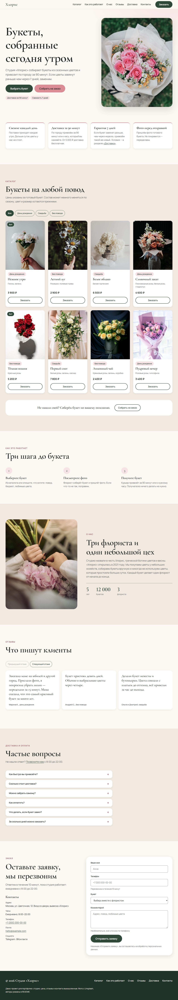
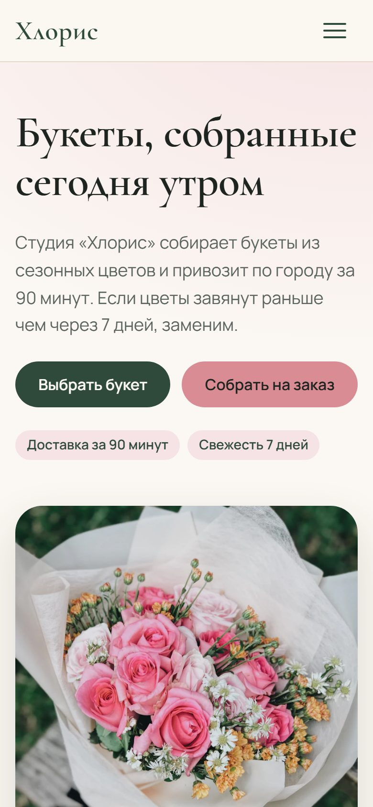

# Кейс: лендинг цветочной студии «Хлорис»

**Сайт:** https://grozeser.github.io/chloris-flower-landing/
**Код:** https://github.com/grozeser/chloris-flower-landing
**Тип:** учебный проект для портфолио, бренд вымышленный · **Стек:** HTML, CSS, JavaScript без фреймворков и сборки

## Задача

Сделать одностраничный сайт цветочной студии, который за минуту отвечает на вопросы покупателя: что можно заказать, сколько стоит, как быстро привезут, и даёт оставить заявку с телефона без регистрации и корзины.

Ограничения, которые я поставил себе сам:
- работает на телефоне не хуже, чем на десктопе (от 320 px);
- доступность на уровне WCAG 2.1 AA;
- страница легче 1,5 МБ и без «прыжков» при загрузке;
- без фреймворков: чтобы показать, что основу — вёрстку, доступность, производительность — я умею без них.

## Что получилось

- **Каталог из 8 букетов** с фильтром по поводу. Кнопка «Заказать» на карточке ведёт к форме и сразу подставляет выбранный букет.
- **Форма заявки** с понятными ошибками («Проверьте номер: нужны 11 цифр…»), состоянием отправки, экраном «Заявка принята» и сообщением о сбое, если пропал интернет.
- **Отзывы** в горизонтальной прокрутке с кнопками, **FAQ** на нативных `
`, мобильное меню.
- **Дизайн-система**: цвета, шрифты, отступы и компоненты описаны токенами и собраны на отдельной странице [styleguide.html](https://grozeser.github.io/chloris-flower-landing/styleguide.html).

| Десктоп, вся страница | Телефон |
|---|---|
|  |  |

## Как работал

Проект шёл по этапам, каждый — отдельный коммит:

1. **План** — секции, стек, критерии готовности.
2. **Дизайн-система** — палитра проверена на контраст скриптом; исходный розовый `#D98C94` даёт на светлом фоне только 2,4:1, поэтому он используется только как заливка, а для розового текста подобран отдельный тон `#9C4A55` (5,6:1).
3. **Тексты** — сначала все тексты в одном документе ([copy.md](copy.md)) с общими фактами (90 минут, 350 ₽, гарантия 7 дней), потом вёрстка. Так тексты не расходятся между секциями.
4. **Разметка** — семантический HTML, мета-теги, Open Graph, JSON-LD `FlowerShop`.
5. **Стили** — mobile-first, сетки 2/3/4 столбца, липкая шапка.
6. **JavaScript** — фильтр, форма, слайдер, появление блоков при прокрутке. Правила проверки полей вынесены в отдельный файл и покрыты тестами (`node --test`).
7. **Фото** — 10 снимков с Unsplash, каждый в WebP двух-трёх размеров через `srcset`. Подписи `alt` и состав букетов переписаны под то, что реально на фото.
8. **Проверка** — доступность, клавиатура, производительность, критика дизайна, [тест-план](testing.md).
9. **Выкладка** на GitHub Pages.

## Решения, которыми доволен

- **Ничего не прячется без JS.** Анимации появления получают только блоки ниже первого экрана, и класс для них ставит сам скрипт. Если JS не загрузился, страница просто показывает всё; фильтр, бургер и кнопки слайдера в этом режиме скрыты, а форма проверяется браузером.
- **Доступность проверена делом, а не чек-листом.** Весь сайт пройден клавиатурой; после «Заказать» следующий Tab попадает в поле имени; экранная читалка слышит «Показано 3 букета» после фильтра; ошибки связаны с полями через `aria-describedby`.
- **Безопасный вывод.** Имя из формы попадает на экран «Заявка принята» через `textContent`, поэтому HTML из поля не выполняется — проверено вводом ``.
- **Честный контент.** Отзывы и контакты вымышленные, и об этом сказано в подвале. Фото с чужим брендом на упаковке и фото с подвявшими цветами я заменил, хотя по поиску они подходили.

## Что нашёл и исправил на проверке

- На ширине 320 px каталог вылезал за экран: колонки `1fr` не сжимались уже кнопки → `minmax(0, 1fr)`.
- Фото карточек брали высоту из атрибута `height` и растягивали страницу до 12 500 px.
- На телефоне фото букета не попадало на первый экран → кнопки в один ряд, теперь видно 235 px букета.
- Восемь тёмных кнопок «Заказать» спорили с фотографиями → контурный вариант кнопки.

## Цифры

| Метрика | Значение |
|---|---|
| Контраст текстов | все 152 текстовых элемента ≥ WCAG AA |
| Сдвиг раскладки (CLS) | 0 |
| Вес фото, десктоп | ≈ 380 КБ |
| Вес страницы на телефоне со шрифтами | ≈ 0,7 МБ |
| Ширина без горизонтального скролла | от 320 px |
| JavaScript | ≈ 8 КБ без библиотек |
| Автотесты | 3 теста правил формы |

## Что сделал бы дальше

- Подключить настоящую отправку заявок (Formspree или Telegram-бот) — сейчас форма демонстрационная.
- Прогнать Lighthouse и проверить с живой экранной читалкой (NVDA, VoiceOver).
- Добавить 3–4 сценария на Playwright: фильтр, заказ из карточки, отправка формы, мобильное меню.

## Инструменты

Git и GitHub, Chrome DevTools, Node.js для тестов. Разработка шла в паре с ИИ-ассистентом Claude Code: он помогал с кодом и проверками, задачу, решения и приёмку каждого этапа вёл я.

---

### Короткая версия для карточки в портфолио

> **«Хлорис» — лендинг цветочной студии.** Одностраничный сайт с каталогом, фильтром и формой заказа на чистых HTML, CSS и JS. Mobile-first от 320 px, доступность WCAG AA (контраст, клавиатура, экранные читалки), CLS 0, ≈ 0,7 МБ на телефоне. Своя дизайн-система, тесты правил формы, выкладка на GitHub Pages.
